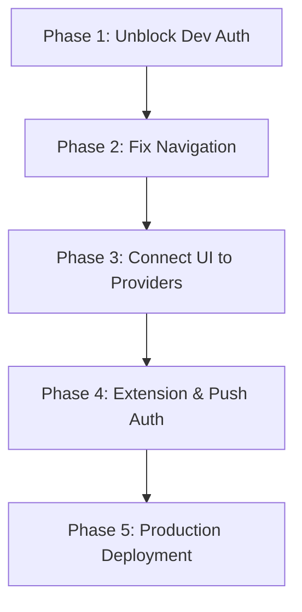

# MitaLeet Ecosystem: Comprehensive Architecture & Code Audit

This document presents a structured audit of the **mitaLeet** platform (also referred to as **LeetCircle**). The audit assesses the alignment between the core product vision and the current technical implementation, evaluates the system architecture, identifies critical gaps and technical debt, and outlines a prioritized roadmap to production readiness.

---

## 1. Executive Summary

MitaLeet is a private social competitive coding platform designed for friend circles who practice on LeetCode. Its goal is to make LeetCode addictive, social, and competitive by offering real-time activity tracking, streaks, gamified leaderboards, multiplayer solve races, and notifications.

### Audit Verdict: **High Technical Readiness, Heavy UI-Data Gaps**
* **NestJS Server (95% Ready):** The backend implementation is highly complete, containing fully realized modules for user profiles, friendships, real-time presence (WebSockets), squads/groups, daily streaks, gamification (XP/levels/achievements), solve races, and background LeetCode scraping. The database schema (Prisma + PostgreSQL) is production-ready.
* **Flutter Mobile App (50% Ready):** The mobile application has a polished, premium tactical aesthetic (graphite theme, metallic gradients, mono typography). However, **almost all primary screens are currently faked with hardcoded mock data** (`HomeScreen`, `ProfileScreen`, `CirclesScreen`, `ActivityScreen`, and `LeaderboardScreen`). Riverpod state providers have been written for these modules but are not yet bound to the UI.
* **Browser Extension (80% Ready):** The Plasmo-based Chrome extension is functional. It intercepts problem submissions and posts them to the server, but relies on the manual copy-pasting of short-lived JWTs.

---

## 2. Product Alignment Matrix

| Product Feature | Expected Product Vision | Technical Backend Status | Mobile Client Status | Alignment Gaps / Issues |
| :--- | :--- | :--- | :--- | :--- |
| **LeetCode Tracking** | Sync user solves, counts, and difficulties automatically. | **Done.** scraping via GraphQL client; full history & manual sync endpoints. | **Done.** `CodingActivityScreen` linked to `leetcodeProvider`. | None. This is the only fully integrated data-driven dashboard screen. |
| **Activity Feed** | Live activity feed (solves, streaks, squad updates). | **Done.** Activities saved to DB; real-time push via Socket.IO. | **Mocked.** `ActivityScreen` shows a static list. `activityFeedProvider` exists but is unused. | UI does not display actual live events or respond to Socket.IO events. |
| **Streak Tracker** | Daily tracking, streak multipliers, and status indicators. | **Done.** Calculated in backend during sync; XP bonus rewards. | **Mocked.** Hardcoded streak values on Home (12d) & Profile (15d). | Real streaks from `leetcodeProvider` are only visible in the `/coding` tab. |
| **Squads (Circles)** | Private code-joined groups with mutual leaderboards. | **Done.** Groups, codes, roles, and squad leaderboards supported. | **Mocked.** `CirclesScreen` shows static squads (DSA Grinders, etc.). | No way to view member profiles, create/join circles, or see squad leaderboards. |
| **Leaderboards** | Friend, squad, and global rankings across periods. | **Done.** Aggregations for daily, weekly, monthly, and all-time. | **Mocked/Broken.** Bottom nav links to static `LeaderboardScreen`. | A dynamic `LeaderboardScreen` exists in gamification module, but is bypassed by routing. |
| **Solve Races** | Real-time lobbies, countdowns, status updates, and auto-checks. | **Done.** Fully event-driven via Socket.IO and REST status endpoints. | **Done.** Lobbies, status selectors, live clocks, and results are integrated. | Minor testing required once auth is unblocked. |
| **Gamification** | Level up, XP rewards, rank badge progression. | **Done.** Levels, badges, XP events, and achievements table. | **Mocked.** Home & Profile display hardcoded values (LVL 3, 2,050 XP). | UI lacks integration with the progression and achievements tables. |

---

## 3. Architecture Evaluation

### NestJS Backend (`apps/server`)
* **Framework:** NestJS 10, utilizing TypeScript and Prisma ORM with PostgreSQL.
* **Modularity:** Highly modular structure. Each domain is isolated into its own NestJS module containing a controller, service, and DTO definitions.
* **Authentication:** Guarded by `JwtAuthGuard` globally (except for `@Public()` endpoints). Verified via Google OAuth.
* **Real-time Infrastructure:** Socket.IO integrated via `EventsGateway`. It manages active socket connections, authenticates handshakes using JWTs, tracks user presence, and broadcasts events (e.g., presence updates, race state changes, XP alerts).
* **Worker Queue / Background Tasks:** A dedicated `SyncService` coordinates automated LeetCode scraping, daily calculations, and streak updates.

### Flutter Mobile App (`apps/mobile`)
* **State Management:** Riverpod (using `StateNotifierProvider` and basic `Provider` patterns). Clean separation between data clients (Dio-based `ApiClient`), state logic providers, and presentation views.
* **Routing:** `GoRouter` setup with a `refreshListenable` listening to `authStateProvider`. Provides seamless transition from login to authenticated shell routes.
* **Theme & UI:** Custom design system implemented via `AppColors` (matte/graphite colors), `AppTypography` (tactical label styles, custom monospaced styling), and premium components (`LCMetallicContainer`, `LCCard`).

### Browser Extension (`apps/extension`)
* **Framework:** Plasmo (React + TypeScript).
* **Storage:** Utilizes `chrome.storage.local` to store the verified API token and user info.
* **Core Logic:** Intercepts submission events on `leetcode.com` pages and sends solve payload (slug, language, timestamp) to backend.

---

## 4. Critical Gaps & Technical Debt

### Blocker 1: Dev Bypass Authentication is Client-Side Only (E2E Dev Blocker)
In `apps/mobile/lib/features/auth/providers/auth_provider.dart`, the `devBypass()` method sets the client-side state to `isAuthenticated = true` in-memory, but does not perform a backend login. 
* **Symptom:** As soon as the user logs in via the dev bypass, the app transitions to the dashboard, but every subsequent network request (fetching profiles, activity feed, leaderboard, friends list) throws a `401 Unauthorized` exception because there is no valid backend JWT in the HTTP headers.
* **Root Cause:** There is no dedicated endpoint in the NestJS server to generate a mock developer session and issue a valid JWT token.

### Blocker 2: App Navigation & Route Reachability
The bottom navigation bar (`LCScaffoldWithNav`) displays 5 tabs: Home, Rank (Leaderboard), Activity, Squad (Circles), and Profile.
* **Issue:** The `/coding` route (representing `CodingActivityScreen`) is defined in `app_router.dart` but is **not accessible in the bottom nav**. The only way to link a LeetCode account is from the `/coding` tab. Consequently, users cannot access the screen to link their LeetCode account from the main application flow.

### Blocker 3: Route Bypassing (Leaderboard Screen Duplicate)
The codebase has two distinct implementation versions of the leaderboard screen:
1. `apps/mobile/lib/features/leaderboard/presentation/screens/leaderboard_screen.dart` (Hardcoded Mock Screen).
2. `apps/mobile/lib/features/gamification/presentation/screens/leaderboard_screen.dart` (Dynamic Screen connected to `gamificationProvider`).
* **Issue:** `app_router.dart` imports and navigates to the **hardcoded version** (1), meaning the actual dynamic leaderboard is dead code.

### Blocker 4: Extension Authentication & Token Expiry
The browser extension relies on copy-pasting the raw JWT token from the mobile app settings.
* **Issue:** The backend access token has a default short lifespan (15 minutes in NestJS core or matching fallback). Once the token expires, the browser extension loses connection and fails to log solves, requiring frequent re-authentication. 
* **Solution Requirement:** The system needs a dedicated, long-lived API key mechanism for external clients (like the extension) or the extension needs to support a refresh token flow.

---

## 5. Prioritized Action Plan / Roadmap

To transition the MitaLeet ecosystem from a mock-heavy prototype to a fully integrated, production-ready product, we should execute the following phases:

### Phase 1: Unblock Dev Auth & E2E Testing
1. **Backend Development Login:** Create a new `@Public()` endpoint `POST /auth/dev-login` on the NestJS backend. When `NODE_ENV !== 'production'`, it will accept a `username` (e.g. `mitali`), find or create the user in the database, register a session, and return a valid JWT token pair.
2. **Mobile Client Integration:** Update the mobile `devBypass()` method in `auth_provider.dart` to make a POST request to `/auth/dev-login`, save the JWT tokens in secure storage, and establish the Socket.IO connection.

### Phase 2: Navigation Adjustments
1. **Update Scaffold:** Modify `LCScaffoldWithNav` and `app_router.dart` to replace the tab indexes or structure so that the `CodingActivityScreen` is reachable. (e.g., swapping the Home tab stats to link to the Coding Activity, or placing the Coding activity directly on the bottom tab bar).
2. **Fix Router Imports:** Update `app_router.dart` to import the dynamic `LeaderboardScreen` from the `gamification` feature instead of the mock `leaderboard` feature.

### Phase 3: Connect UI Screens to Providers
1. **HomeScreen:** Fetch user stats, streak, daily goal progress, and recent activity from `leetcodeProvider` and `activityFeedProvider` instead of showing mock data.
2. **ProfileScreen:** Bind profile stats and the difficulty bar charts to the verified LeetCode stats fetched from `leetcodeProvider`.
3. **CirclesScreen:** Create a `groupsProvider` on the client that talks to the existing `/groups` API controller, allowing users to view real squads, join via a code, or create a squad.
4. **ActivityScreen:** Bind the list to the existing `activityFeedProvider` and listen to Socket.IO events for live updates.

### Phase 4: Extension Security & Push Notifications
1. **Long-lived Extension Auth:** Add an API Key entity to the database schema. Allow users to generate a long-lived extension token from the profile settings. Update `leetcode.controller.ts` to accept either JWT or API Key for `/extension-solve`.
2. **FCM Key Setup:** Populate actual Firebase keys in `.env` and verify device token registration flow on Android/iOS devices.

### Phase 5: Verification & Launch
1. Run database migrations on production postgres.
2. Build production APK/IPA.
3. Publish browser extension to Chrome Web Store.
